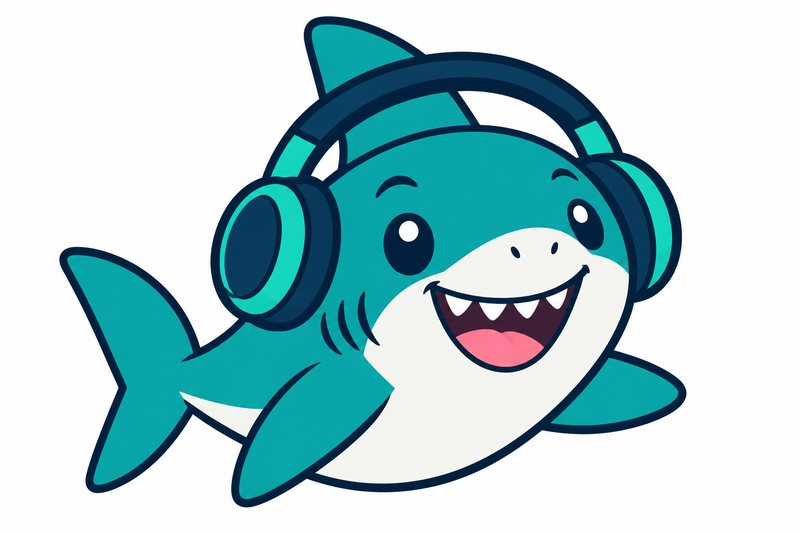
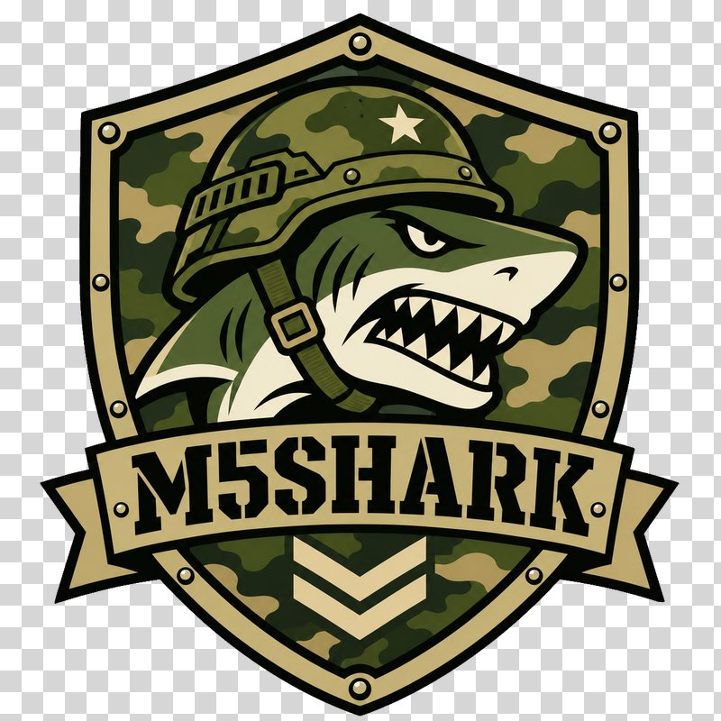

# Claude Code Image Generator

An MCP server that lets **Claude Code** (and Claude Desktop) generate and edit
images with **ChatGPT's image model**, using your **ChatGPT subscription**.
No OpenAI API key needed.

> Unofficial community project. Not affiliated with or endorsed by Anthropic or OpenAI.

| Tool | What it does |
|---|---|
| `generate_image` | Text → image. Shape (square / landscape / portrait), quality, 1–4 images, **transparent background**, png / jpeg / webp. |
| `edit_image` | Edit a picture, or combine up to 16 reference images into one. |

Every image is saved to disk at full size, and Claude gets the file path plus a
small preview so it can see the result and refine it.

## Examples

All made from Claude Code with a ChatGPT Plus account. Each took 25–45 seconds.

<table>
<tr>
<td width="50%" valign="top">

<br><b><code>generate_image</code></b>
<br><sub>"a cute cartoon shark wearing headphones, flat vector style, teal and navy, white background"</sub>
</td>
<td width="50%" valign="top">

<br><b><code>edit_image</code></b> with the image on the left as input
<br><sub>"make the shark purple and add small golden stars around it, keep the same style"</sub>
</td>
</tr>
<tr>
<td width="50%" valign="top">

<br><b><code>generate_image</code></b> with <code>background: "transparent"</code>
<br><sub>"a die-cut sticker of a cool cartoon shark DJ wearing sunglasses and headphones, bold outlines, vibrant purple and teal"</sub>
</td>
<td width="50%" valign="top">

<br><b><code>generate_image</code></b> with <code>background: "transparent"</code>
<br><sub>"M5SHARK logo in a military army style: a shark in a combat helmet on a camo badge, stencil lettering"</sub>
</td>
</tr>
</table>

<sub>The checkerboard shows where the background is transparent. Previews are scaled down; real outputs are 1254×1254 to 1536×1024.</sub>

## How it works

```
Claude ──MCP──▶ server.py ──▶ Codex CLI (signed in with ChatGPT) ──▶ GPT Image
```

OpenAI's **Codex CLI** has a built-in image generator that works with a ChatGPT
login. This server runs `codex exec` in the background (read-only sandbox, no
shell commands, nothing saved to your Codex history), asks it for the image,
then picks the file up from `~/.codex/generated_images/` and saves it where you want.

- Images count against your **ChatGPT plan's limits** (Plus, Pro, Business…),
  not API billing. The Free plan can't generate images in Codex.
- Each image takes about 20–60 seconds.
- **Transparent backgrounds:** the server asks for a flat green screen (or
  magenta when the subject itself is green, e.g. army, camo or forest themes)
  and removes it itself, leaving a clean PNG cut-out.
- Prefer pay-per-image with exact control? Set `IMAGE_BACKEND=api` and use an
  OpenAI API key instead (see below).

## Requirements

1. **Codex CLI, signed in with your ChatGPT account**
   - **macOS:** the ChatGPT desktop app already includes it. The server finds it automatically.
   - **Anywhere else:** install it from [github.com/openai/codex](https://github.com/openai/codex),
     for example `npm install -g @openai/codex`, then run `codex login` and choose
     *Sign in with ChatGPT*.
   - Check it: `codex login status` should say `Logged in using ChatGPT`, and
     `codex features list` should show `image_generation` enabled.
2. **[uv](https://docs.astral.sh/uv/)**. It installs the Python dependencies
   automatically the first time the server starts.

## Install

```bash
git clone https://github.com/M5Shark/claude-code-image-generator.git
cd claude-code-image-generator
claude mcp add chatgpt-images --scope user -- uv run --script "$PWD/server.py"
```

Start a new Claude Code session. `claude mcp list` should show
`chatgpt-images: ✓ Connected`.

> If Claude Code can't find `uv`, use its full path (`which uv`) in the command above.

### Claude Desktop (chat)

Add this to `claude_desktop_config.json` (macOS:
`~/Library/Application Support/Claude/`), then restart Claude Desktop:

```json
{
  "mcpServers": {
    "chatgpt-images": {
      "command": "/full/path/to/uv",
      "args": ["run", "--script", "/full/path/to/claude-code-image-generator/server.py"]
    }
  }
}
```

## Usage

Just ask Claude:

- "Generate a landscape hero image for a music producer's landing page, dark purple neon"
- "Make a transparent sticker of a shark DJ with headphones and save it to ./assets"
- "Make an army-style logo for my brand with no background"
- "Edit ~/Desktop/product.jpg: put the product on a marble counter with soft morning light"
- "Combine these three photos into one flat-lay shot: a.png, b.png, c.png"

Images go to `~/Pictures/ChatGPT Images` unless you ask for another folder.
In a project, Claude can save straight into it (e.g. `./assets`), which is handy
for websites and games.

## Settings

All optional. Copy `.env.example` to `.env` (next to `server.py`), uncomment what
you need, then restart Claude.

| Variable | Default | Meaning |
|---|---|---|
| `IMAGE_OUTPUT_DIR` | `~/Pictures/ChatGPT Images` | Default save folder |
| `IMAGE_PREVIEW_MAX_PX` | `768` | Preview size sent to Claude; `0` turns previews off |
| `CODEX_PATH` | auto-detected | Path to the `codex` binary |
| `CODEX_MODEL` | Codex default | Model that drives Codex (the image model itself is chosen by OpenAI) |
| `CODEX_REASONING_EFFORT` | `low` | Keeps each run quick |
| `CODEX_TIMEOUT` | `600` | Seconds to wait for one request |
| `IMAGE_BACKEND` | `chatgpt` | `api` uses the OpenAI Images API instead |
| `OPENAI_API_KEY` | – | Only for `IMAGE_BACKEND=api` |
| `OPENAI_IMAGE_MODEL` | `gpt-image-2` | Only for `IMAGE_BACKEND=api` |

### API backend

`IMAGE_BACKEND=api` calls the OpenAI Images API directly with a key from
[platform.openai.com](https://platform.openai.com/api-keys). It's billed per image,
separately from ChatGPT plans, and gives exact pixel sizes, native transparency
and masks for `edit_image`.

## Limits of the ChatGPT backend

- `size` sets the shape; ChatGPT picks the exact pixels (e.g. 1254×1254, 1536×1024).
- No masks: describe the area to change in the prompt instead.
- OpenAI doesn't publish an image count for Codex. If you hit your plan's limit,
  the tool returns ChatGPT's message and you can continue after the reset.
- Use is subject to OpenAI's terms for your ChatGPT plan.

## Troubleshooting

- **"did not return an image … sign in"**: run `codex login status`; sign in again if needed.
- **"Could not find the Codex CLI"**: install it (see Requirements) or set `CODEX_PATH`.
- **Server not connecting**: run `uv run --script server.py` in a terminal. It
  should sit waiting with no error (Ctrl+C to stop).

## Tests

Offline tests use a fake `codex` binary and a mock OpenAI API, so they need no
account and use no quota:

```bash
uv run --script tests/test_server.py
```

## License

[MIT](LICENSE)
